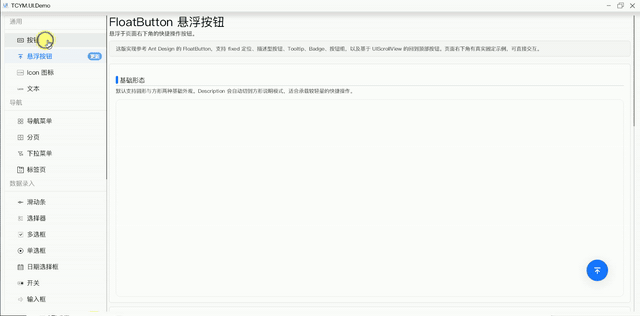

# TCYM.UI.Example

TCYM.UI.Example 是一个可独立构建和运行的 TCYM.UI 示例工程，用于对外展示基础组件、声明式路由、Chart 图表、数据绑定、布局与样式、SDL3 输入事件及跨平台窗口能力。

这个仓库通过 NuGet 引用 `TCYM.UI 0.1.1.25`、`TCYM.UI.Chart 0.1.1.26` 和独立扩展 `TCYM.UI.WebView 0.1.1.1`，不依赖上级源码目录中的项目，因此可以单独复制、构建和发布。`TCYM.UI` 已内置 Generator analyzer，可直接使用 Binding V2 编译期绑定。公开仓库不包含 `TCYM.UI.Pro`、Player、PlayerDetection、MvGigECamera 等 Pro 示例源码及其运行依赖。

## 文档地址

[https://tcym.top:8035/tcym/UI/Doc/index.html](https://tcym.top:8035/tcym/UI/Doc/index.html)

## 演示视频

[](demovideo.mp4)

点击上方预览图打开演示视频，或下载 [demovideo.mp4](demovideo.mp4) 查看。

## 环境要求

- 项目同时面向 .NET 8 和 .NET 10，推荐使用 .NET 10 SDK 构建
- 运行框架依赖版本需要对应的 .NET 8 或 .NET 10 Runtime；自包含或 Native AOT 发布包无需单独安装 Runtime
- Windows、Linux 或 macOS 桌面环境
- `TCYM.UI` NuGet 包已包含 Windows、Linux 和 macOS 对应的 SDL3 与 SkiaSharp 4.152.1 本地运行库
- WebView 在 Windows x64/arm64 需要 WebView2 Runtime；Linux 的 X11 / 原生 Wayland 需要 GTK 3 和 WebKitGTK 4.1。macOS 暂无公开 WebView 后端，Linux ARM64 / 原生 Wayland 请在目标设备验证

## 演示内容

- 应用结构：登录演示、声明式路由、加载动画、延迟加载、页面预加载与退出登录
- 渲染与线程：Windows D3D12、跨平台 OpenGL/CPU 后端，以及窗口级多线程渲染
- 基础组件：Button、Cascader、Loading、Popconfirm、Anchor、Menu、Tabs、Table、Tree、TreeSelect 等
- 数据绑定：Binding V2 强类型属性、双向绑定、集合绑定与编译期访问器生成
- 数据录入：Input、Autocomplete、Checkbox、Radio、Select、DatePicker、TimePicker、ColorPicker、Slider 等
- 数据展示与反馈：Badge、Carousel、Timeline、Notification、Message、Modal、Progress、Watermark 等
- CSS 能力：`@import`、变量、`:has()`、结构/函数伪类、动画、过渡、2D/3D transform、text-shadow、user-select 等
- Chart 图表：Line、Bar、Pie、Gauge、Scatter、Candlestick、Radar、Graph、Tree，以及 TreeMap 矩形树图的层级、渐变映射和磁盘占用示例
- SDL3 能力：触控笔、触摸、文件拖放、手柄/摇杆输入和窗口状态事件
- 其他组件：WebView 网页视图（含离线页面）、分隔面板、虚拟滚动、文件选择、USB 摄像头等

## 目录说明

- `Assets`：示例所需图片、字体等资源
- `Page/component`：公开基础组件演示代码
- `Page/Charts`：TCYM.UI.Chart 图表示例和公开演示资源
- `Page/Layout`：登录、全局路由与主布局代码
- `Libs`：TCYM.UI 相关许可文件
- `publish-aot.bat`：基于 .NET 10 和 AotAnywhere 的跨平台 Native AOT 发布脚本
- `publish-.net8-aot.bat`：对应的 .NET 8 Native AOT 发布脚本
- `Program.cs`：示例程序入口

## 构建与运行

在仓库根目录执行：

```bash
dotnet restore
dotnet build TCYM.UI.Example.csproj
dotnet run --project TCYM.UI.Example.csproj --framework net10.0
```

也可以运行 .NET 8 目标：

```bash
dotnet run --project TCYM.UI.Example.csproj --framework net8.0
```

## Binding V2

`TCYM.UI` 包已包含源生成器，无需单独引用 `TCYM.UI.Generator`，也无需在入口手动调用生成的初始化方法。完整示例位于 `Page/component/Binding`。

自定义组件应在定义组件的项目中声明为 `partial`，并使用 `[BindingProperty]` 标记目标属性；需要自动扫描安全公开属性时，在该项目添加 `[assembly: GenerateBindingProperties]`。程序集特性只对当前项目生效。

## WebView 示例

从“其他 → WebView”进入。示例默认从程序集加载两份内嵌 HTML，可演示导航、JavaScript 和字符串/JSON 双向消息；离开页面时关闭浏览器实例。在线地址可以手动输入，脚本与消息演示仅对内嵌页面启用。

入口已在 `UISystem.Initialize` 前调用 `UIWebViewRuntime.PrepareNativeHosting()`，以准备原生 Wayland 宿主。浏览器引擎由系统提供，Native AOT 不会将 WebView2 Runtime 或 WebKitGTK 打入程序。

## Native AOT 发布

项目使用 `StuDev.AotAnywhere 1.0.4`，发布脚本默认基于 `net10.0`，可在 Windows 上交叉发布 Windows、Linux 和 macOS 的 x64/arm64 版本：

```bat
publish-aot.bat
```

也可以只发布单个平台：

```bat
publish-aot.bat win-x64
publish-aot.bat linux-arm64
publish-aot.bat osx-arm64
```

使用 .NET 8 发布时执行：

```bat
publish-.net8-aot.bat win-x64
```

两套脚本的发布结果分别整理到：

```text
bin/Release/net10.0/publish/<RID>-AOT/
bin/Release/net8.0/publish/<RID>-AOT/
```

## 许可证说明

- 示例源码使用 MIT License，见根目录 LICENSE。
- TCYM.UI 相关包请按随附许可证使用，见 `Libs/LICENSE-TCYM.UI.txt`。
